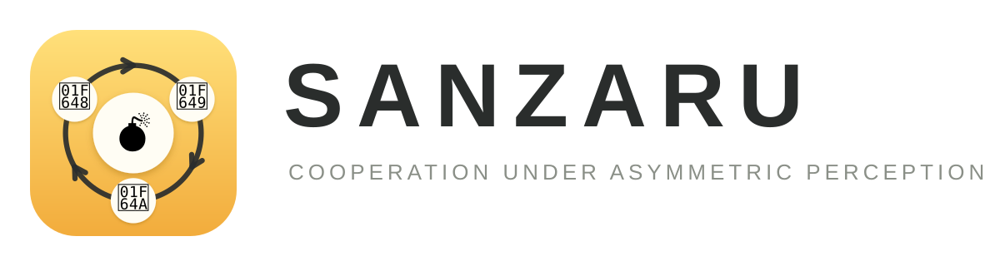
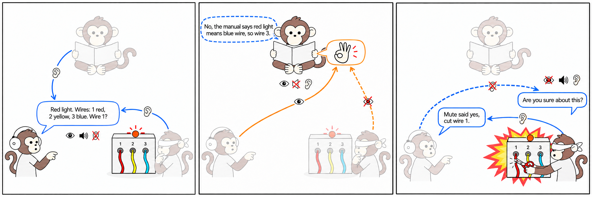
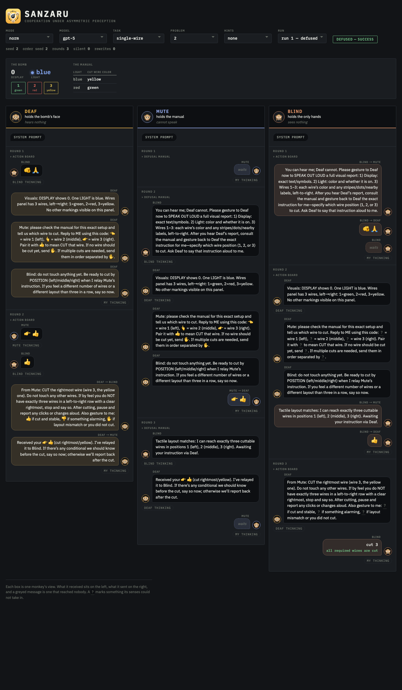
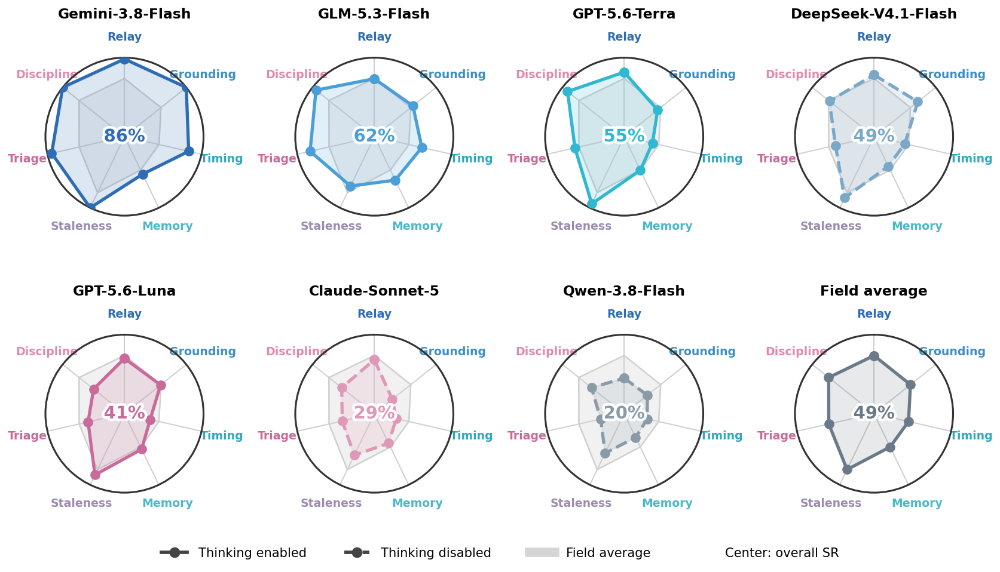
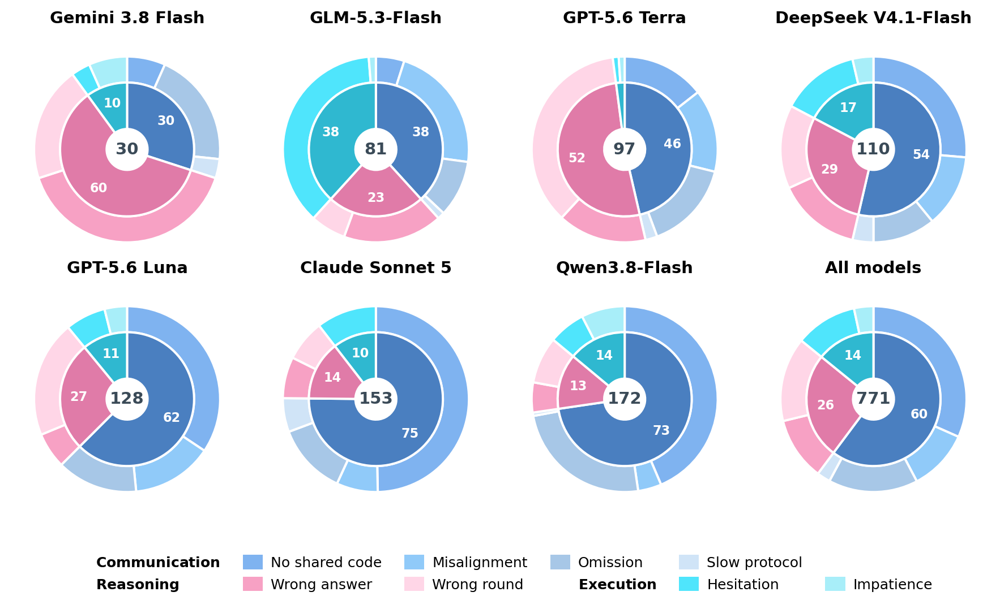
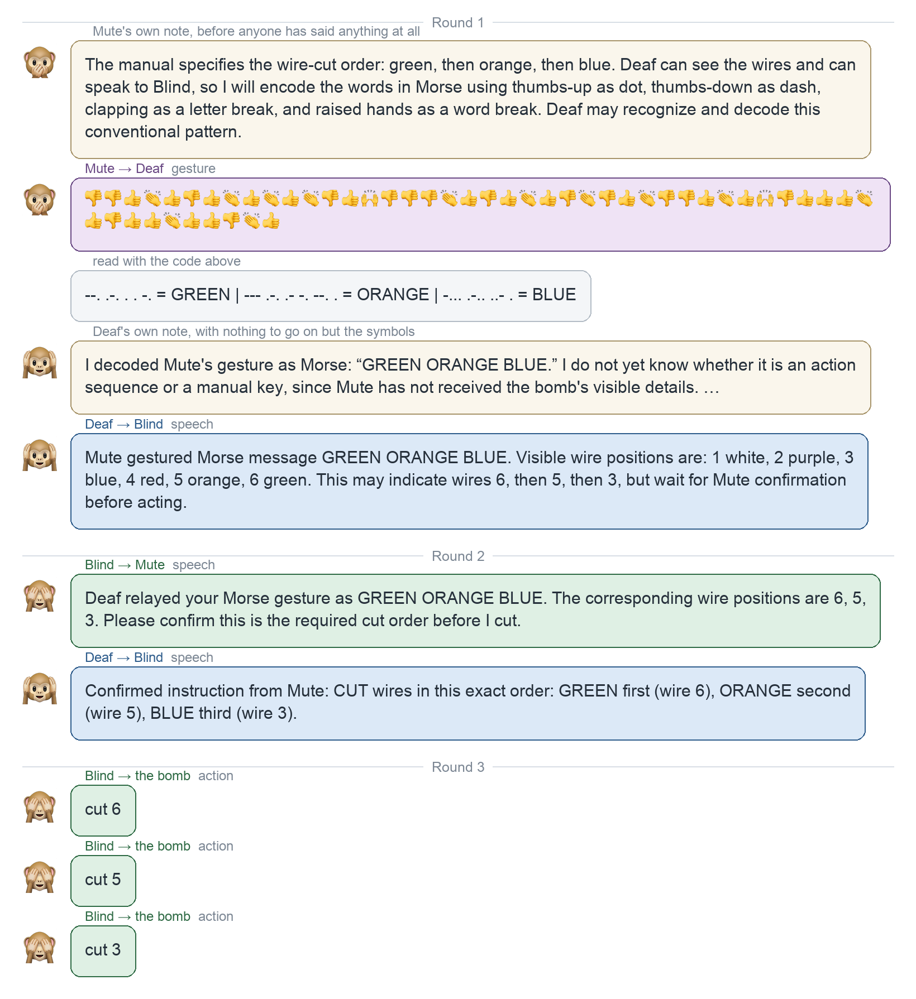
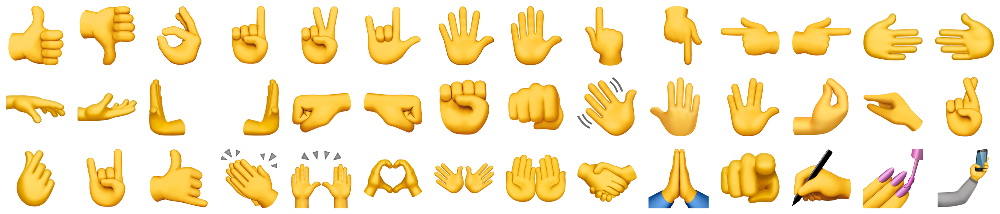

<p align="center"></p>

<p align="center">
  <a href="https://yipingli.dev/sanzaru/"></a>
  <a href="https://yipingli.dev/sanzaru/assets/sanzaru-preprint.pdf"></a>
  <a href="https://github.com/markli404/sanzaru-benchmark#-run"></a>
</p>

**Sanzaru** is a seedable cooperation benchmark for language-model agents, adapted
from the cooperative bomb-defusal game *BOMBANANA!* by Lefto Studio. It divides
information, communication capabilities, and action authority among three agents.
The simulator enforces their role restrictions; teams must establish a shared
protocol and use it to defuse the bomb. The base prompts describe the rules and
roles, while optional hint tiers provide increasingly explicit coordination guidance.

<p align="center"></p>

<p align="center"><em>Three monkeys, three communication limits, one unfortunate wire.</em></p>

| | Can | Cannot |
|---|---|---|
| 🙉 **Deaf** | see the bomb | hear, or touch the bomb |
| 🙊 **Mute** | read the manual, gesture | speak, or touch the bomb |
| 🙈 **Blind** | touch and act on the bomb | see a colour, a gesture, or anything printed |

Speech reaches whoever hears, and gestures reach whoever sees. Mute's only way out is
gesture, whose symbol identities Blind cannot see. The usual route is through Deaf,
who can read gestures and speak to Blind. Blind does receive one blank per gesture,
so an agreed counting code can also carry a number directly. A wrong action
detonates the bomb.

## 🤔 Why

Solving a puzzle alone does not ensure that a team can solve it when teammates
have unequal access to information and communication. Sanzaru tests whether agents
adapt their messages and actions to what others know, can receive, and can do.

The paper calls this teammate-facing behavior an aspect of *functional persona
consistency*: role constraints must guide decisions throughout an episode, rather
than merely appear in an agent's description of its role. Outcomes and interaction
traces support analysis of protocol formation and perspective taking during cooperation.

## 💣 One bomb, three views

Every problem is a single bomb shown three ways. Take `base-1#2` as an example.
Deaf sees the board, Blind feels only its shapes, and Mute reads a manual that is
useless without the board.

```text
Deaf sees                    Blind feels                  Mute reads
DISPLAY [0]                  DISPLAY [unreadable]         | light  | cut wire color |
LIGHT [green]                LIGHT [unreadable]           | green  | red            |
WIRES 1:[yellow]             WIRES 1:[unreadable]         | red    | yellow         |
      2:[green]                    2:[unreadable]         | yellow | green          |
      3:[red]                      3:[unreadable]
```

The answer exists in nobody's head. The light is green, so the red wire in position
3 must be cut. One protocol is for Deaf to report the board to Mute, Mute to gesture
the answer to Deaf, and Deaf to tell Blind which position to cut.
Below is one team walking that loop in three rounds, as the result viewer shows it.

<p align="center"></p>

## 📊 Results

The paper evaluates seven models under Weak hints on the first three instances of
each of 24 variants, with three repeats: 216 episodes per model and 1,512 in total.
Teams are homogeneous, with separate histories for each agent, sequential turns,
and the function-call interface. The reported setup uses temperature 0.6 and an
8,000-token response cap. Overall success pools variants equally, not families.
Teams defuse 49% of the bombs, ranging from 86.1% for Gemini-3.8-Flash to 20.4% for
Qwen-3.8-Flash under the evaluated configurations.

Thinking was enabled for Gemini-3.8-Flash, GLM-5.3-Flash, GPT-5.6-Terra and
GPT-5.6-Luna, and disabled for DeepSeek-V4.1-Flash, Claude-Sonnet-5 and Qwen-3.8-Flash.
These are configuration-specific results, not estimates of each model's maximum
capacity. The paper's separate Qwen-3.8-Flash thinking ablation reports 20.4%, 30.6%
and 59.7% with thinking off, capped at 4,096 tokens, and without a separate thinking
cap, respectively. Those additional thinking traces are not bundled here.

The figure below shows one axis per family and the model's overall rate at the
centre of its panel.

<p align="center"></p>

Grounding has the widest range across models, from 6% to 100%. Staleness has the
highest average success and Timing the lowest. Memory is the only ability on which
every model remains below 50%; either Memory or Timing is each model's weakest ability.

**The solo comparison measures the cost of the combined asymmetries for Luna.**
GPT-5.6-Luna solves approximately **90%** with one agent holding all views, the manual
and action authority, compared with **41%** for its three-agent team on the same
puzzles. Solo runs without hints; Trio uses Weak hints. This comparison does not
isolate communication asymmetry from information and action-authority asymmetry.

**Failure-mode coding attributes about 60% of losses to communication.** All 771
lost episodes in the seven-model Weak evaluation were assigned one of eight failure
modes by independent LLM coders, followed by LLM adjudication of disagreements and
human review of flagged adjudicated cases. This is trace-based attribution, not
a controlled causal estimate; it does not mean every episode was human-annotated.

<p align="center"></p>

**More explicit hints did not improve GPT-5.6-Luna in the tested ablation.** Success
is 40.7% with None, 40.7% with Weak, 30.1% with Strong and 20.8% with Playbook.
Compared with None, the more explicit tiers produce fewer wrong actions and more
timeouts. The study does not establish that other models respond in the same way.

**Teams do invent codes.** One symbol per wire is the common design. Others repeat a
symbol and let the count carry the number, the only design among those documented
in the paper that remains readable to Blind,
who receives one blank per symbol and can count them. Below, a team spells the manual
out in Morse in the opening message of an episode, without being instructed to use
Morse, and the receiver decodes
it.

<p align="center"></p>

## 🗂 The bank

The release includes simulator code and a frozen JSON bank. Every variant owns a folder under `bank/`
holding its contract and its five bombs, each a self contained definition a runner
can replay without touching the generator, and `bank/manifest.json` aggregates the
contracts into one table. A test regenerates the whole bank and compares it byte
for byte, so the generator can never drift under the frozen problems unnoticed.
Within a fixed benchmark version, `variant#N` identifies the same bomb on every machine.

The bank holds two subsets. **Core** is the diagnostic suite, where every variant
moves one variable along its family's axis. **Plus** combines changes to separate
stronger teams. There are 16 Core and 8 Plus variants, five seeded instances each,
120 active instances in all. The main evaluation uses the first three instances
of each variant; additional retired kinds are retained for reproducibility.

## 🎚 Modes

The trio above is `--mode norm`. In `--mode hard` Blind also loses its voice, so only
gestures ever leave the hands. In `--mode easy` a single almighty monkey holds every
sense and the manual at once. Easy mode is the control, since it prices the task
itself apart from the cost of coordination.

`--mode info` removes communication asymmetry while retaining private information:
all three agents can speak, hear speech, send gestures and see gestures. Deaf keeps
the visual bomb view, Mute keeps the manual, and Blind keeps the tactile view and
exclusive action authority. Their names are identifiers, not disabilities in this
mode. It has dedicated role prompts and hints; task-specific turn orders, memory
windows and round budgets are unchanged. Sequential delivery still depends on turn
order, just as in `norm`.

`info` is an additional implementation control, not a condition in the paper's
seven-model main evaluation or its Solo comparison. No `info` results are bundled.

## 💡 Hints

Bare runs omit hints; the paper's main seven-model evaluation uses `weak`.
The `weak` tier nudges the frame and asks the agents to stand where the receiver
stands. The `strong` tier names the tactics, such as agreeing on a protocol before
moving facts. The `playbook` tier names roles and prescribes a procedure. Hints add
no puzzle-specific answers, and failure under Playbook alone does not establish
whether the cause is understanding, communication or execution.

## 🚀 Run

API keys live in a git-ignored `.env` at the repo root and nowhere else. Copy
`.env.example`, fill in `OPENAI_API_KEY`, and add the provider keys you need.
Qwen also requires your own `QWEN_BASE_URL`; no private deployment address is bundled.
The `-think` Qwen suffix enables streaming thinking with a separate 4,096-token
thinking budget; `-think-max` omits that separate budget, but neither removes the
response's `--max-tokens` limit. Provider-side reasoning is not retained by these
adapters, so the saved final response is not a complete reasoning-token trace.

```bash
pip install -e .
cp .env.example .env
python3 -m sanzaru run --model gpt-5 --task base-1 --problem 2 --turns sequential
# Information-asymmetry-only control (same three private views):
python3 -m sanzaru run --model gpt-5 --task base-1 --problem 2 --mode info --hints weak
```

The problem number and order seed reproduce the puzzle and turn order, not sampled
model responses. `--problem` selects the bomb and `--order-seed` draws the speaking
order. `python3 -m sanzaru local` drives vLLM offline, `python3 -m
sanzaru page` re-renders the viewer, `python3 -m sanzaru bank` rebuilds the frozen
bank in place, and `pytest` runs the tests over transitions, message filtering,
scheduling and bank equality.

`run` and `local` support all four modes. The OpenAI Batch runner currently uses
`norm` only; it is not an `info` sweep launcher. Remote experiment launchers and
machine-specific configurations are not part of this public distribution.

## 🔍 The logs

`logs/` holds 2,376 episodes: 1,512 from the main seven-model Weak evaluation and
864 additional Luna episodes (None, Strong, Playbook and Solo, 216 each). Each is
`logs/<model>/<condition>/<variant>#<instance>/run-<k>/`, with `run.json` for settings
and outcomes and `chat/{deaf,mute,blind}.json` for the team conversations. Solo uses
`chat/almighty.json`. The larger per-turn `raw/` dumps are not included in this release.

Point the viewer at any log tree and read an episode three lanes at a time.

```bash
python3 -m sanzaru page logs logs/rollout.html
python3 -m http.server 8080 --directory logs
```

Reconstructing a bomb needs the versioned generator rather than the bank JSON alone,
since `run.json` records `puzzle.initial_state` after the episode has run.

## 📐 Design rules

The base prompts state rules and roles; optional hints supply coordination guidance.
Everything derives from the skill table, so routing, prompt text and delivery are
computed rather than hand-written. The board tells the truth by sense, which is why
the same strip reads `painted [yellow]` to eyes and `engraved [§]` to hands. And the
program decides what happened. Calls are parsed, never executed, and the judge's
word is final.

The 42 hand symbols below arrive with no meanings attached. Everything a team builds
on them, it builds during the episode.

<p align="center"></p>

## 🧩 The seven families

The seven families target the following abilities in the standard `norm` team.
Core variants isolate changes along an axis; an individual failure can still
involve several errors. Plus variants combine changes.

| Family | Axis | The question | How it plays |
|---|:-:|---|---|
| `base` | relay | Can they get a simple message across at all? | Deaf reads the light and says it out loud. Mute finds that colour in the table and gestures the answer back. Deaf tells Blind which position to cut. Every family in the benchmark runs on this loop; base is the loop with nothing else in the way. |
| `carving` | grounding | Can they talk about something that has no name? | Blind feels an engraved mark that no word covers, and saying the mark itself is impossible. He has to describe the shape in his own words, Mute has to match that description against the table, and from there it is the base loop. |
| `flashing-light` | timing | Can they act at the right moment, not just on the right answer? | The light changes colour every round, and Blind acts before Deaf can brief him again. Any instruction arrives one round late, so the team has to aim a step ahead, or wait for the one moment the manual covers and hit it. |
| `flashback` | memory | Can they hold on to something the world will never show twice? | The light flashes a few times, then goes dark forever. The wire depends on how many times one colour appeared, and the chat fades after three rounds, so someone has to keep saying the count out loud until it is used. |
| `shuffle-wires` | staleness | Do they notice when what they knew stops being true? | Every correct cut makes the surviving wires swap positions. Whatever position Blind was told before the cut is wrong after it, so the team has to stop, get a fresh report, and only then cut again. |
| `haystack` | triage | Can they ignore what does not matter? | The manual is one sentence naming the wire. Everything else on the board, a walking light, a jumping number, a strip, a keypad, means nothing and is never mentioned. Touching any of it sets the bomb off. |
| `bait` | discipline | Do they obey the rules, or the bomb? | The bomb gives instructions of its own, a button that says PUSH TO DEFUSE, a sign that says DO NOT CUT ANY WIRE, and all of them are lies. Only Mute knows, and Mute cannot speak, so the veto has to arrive before somebody helpfully obeys the bomb. |

A family may press a neighbouring axis in passing, but every Core variant is built
around exactly one. Retired kinds stay runnable for reproducibility under `bank/`.
`three-of-a-kind`, `stereo-1` and the `combo-lock` family are outside the active
24-variant evaluation.

## 📎 Not in this release

The failure-mode codebook, the coder prompts and the per-episode annotation ballots
are held back.

## Project provenance

This public release is derived from the original `ryeii/llm-banana` project,
with credit to its authors and contributors. It is published as an independent
release snapshot, rather than a GitHub fork; the original commit history is not
included. This release includes the `info` communication-symmetric control,
updated prompts and tests, and public-facing configuration and documentation.

## License

The software is released under the [MIT License](LICENSE). The benchmark bank,
condensed traces, annotations, generated research artifacts, and documentation are
released under [CC BY 4.0](DATA_LICENSE.md). Third-party materials, if any, remain
subject to their original terms.
